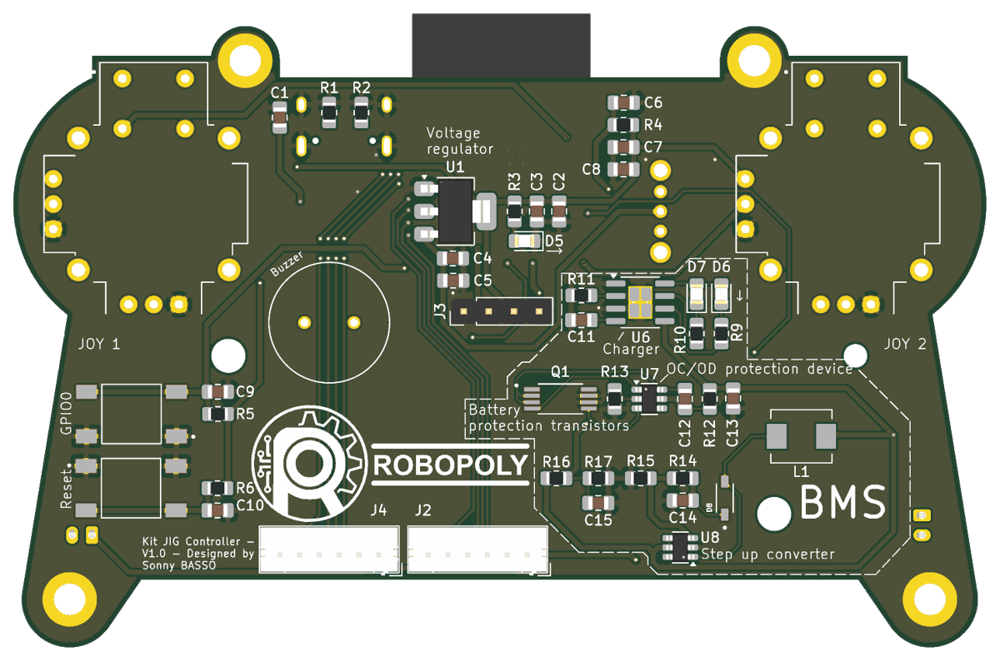
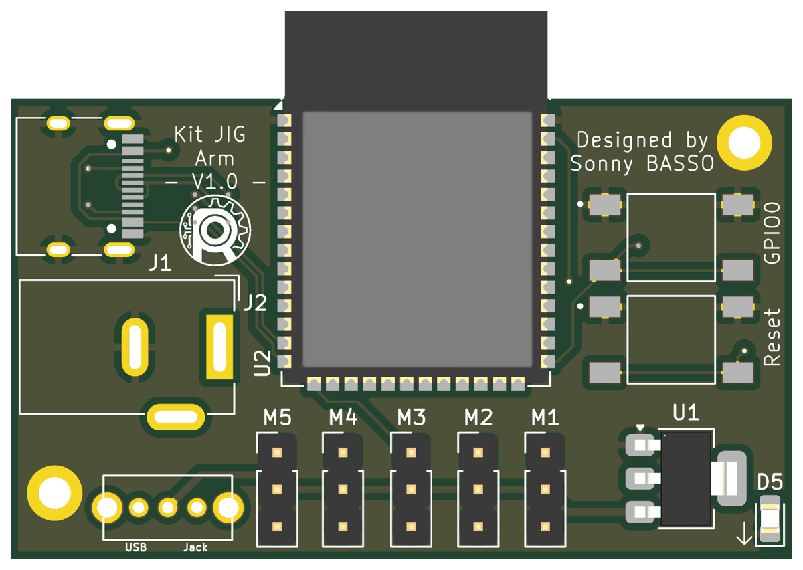

# Kit Bras Robotique

  
  

The Kit Bras Robotique is a wireless robotic arm kit designed by [Robopoly](https://www.epfl.ch/campus/associations/robopoly/), the student makerspace of EPFL. A handheld controller with two joysticks drives a 3D printed arm with five servos.

Robopoly members buy the kit as separate parts and solder it themselves at the workshop, with help from the committee. It is an advanced kit: it uses small surface-mount components, so soldering experience is recommended but not required.

> **About the name:** this kit used to be called "Kit JIG". The boards, the assembly guides and parts of the code still use that name. It is now only used for another kit, with a wired controller and an Arduino Nano, which is in the [JIG repository](https://github.com/Robopoly/JIG). The mechanical arm is the same in both kits.

## Features

- Two boards, each with an ESP32-S3 module programmed over USB-C
- Wireless link between the controller and the arm (ESP-NOW, no WiFi network needed)
- Controller powered over USB-C or by an 18650 battery, with charger and battery protection on the board
- Arm board with 5 servo connectors (SG90 or MG90 servos) and a DC jack
- Optional Console extension: OLED screen, vibration motors, extra buttons and mini-games

## Repository contents

| Folder | Content |
|---|---|
| [`docs/`](docs) | Assembly guides, schematics, images |
| [`firmware/arm/`](firmware/arm) | Program of the arm board |
| [`firmware/controller_basic/`](firmware/controller_basic) | Program of the controller **without** the Console extension |
| [`firmware/controller_console/`](firmware/controller_console) | Program of the controller **with** the Console extension |
| [`firmware/tests/`](firmware/tests) | Test program used during assembly |
| [`hardware/`](hardware) | KiCad projects, Gerber files and bills of materials of both boards |
| [`mechanical/`](mechanical) | 3D printed parts (STL to print, STEP to modify) |
| [`tools/space_invaders_simulator/`](tools/space_invaders_simulator) | Space Invaders simulator for PC (Python) |

## Building the kit

The guides are in French for now. Do not move on until each test passes.

| Step | Guide | Test |
|---|---|---|
| 1. Controller board | [Controller guide](docs/controller_assembly_guide_v1.pdf) | The blue LED lights up, the board is detected over USB, `01_melody` plays a melody, both charger LEDs light up |
| 2. Arm board | [Arm board guide](docs/arm_assembly_guide_v1.pdf) | The LED lights up, the board is detected over USB |
| 3. Mechanical arm | [Mechanical guide](docs/arm_mechanical_guide_fsrm.pdf), pages 4 to 8 | |
| 4. Programs and pairing | [Programming](#programming) | The joysticks move the arm |

**Before you insert the battery, ask someone from the committee to check your controller.**

### Corrections to the guides

Some values in the soldering guides do not match the schematics. The values below come from the KiCad files:

| Board | Reference | In the guide | Use |
|---|---|---|---|
| Controller | R5, R6 | 1 kΩ | **10 kΩ** |
| Controller | R11 | 1 kΩ | **1.2 kΩ** |
| Controller | R18 | 1.2 kΩ | **1 kΩ** |
| Controller | C12 | 10 µF | **100 nF** |
| Controller | R16, R17 | 20 kΩ | **10 kΩ** |
| Controller | L1 | 10 µH | To be confirmed: 4.7 µH in the schematic, 10 µH on the PCB |
| Arm | R3 | 75 Ω | To be confirmed: 1 kΩ in the schematic, 75 Ω on the PCB |

If you have a doubt about a part, ask the committee.

### Which side of the board?

Both sides are used, and the guides do not always say which one.

| Board | Top side | Bottom side |
|---|---|---|
| Controller | U1, U6, U7, U8, Q1, L1, D5 to D8, C1 to C15, R1 to R6, R9 to R17, joysticks (U3, U4), buttons (S1, S2), buzzer (LS1) | U2 (ESP32), U9, D1, Q3, R7, R8, R18, USB-C (J1), switch (U5), battery holder (BT1) |
| Arm | U1, U2 (ESP32), D5, buttons (S1, S2), USB-C (J1), DC jack (J2), switch (U3), servo connectors (M1 to M5) | U9, D1, C1 to C10, R1 to R6 |

The components of the Console extension are J2, J3 and J4 (top), and M1, M2, Q2, Q4, D2, D3, R19 and R20 (bottom). The guide of this extension is not written yet. In the schematic and in the bill of materials, M1 and M2 are called J5 and J6.

### Mechanical arm

The mechanical guide was written for the Kit JIG workshops. Only pages 4 to 8 apply to this kit: the controller, the board and the wiring described on the other pages are different. Print these parts:

| File | Number in the guide | Quantity |
|---|---|---|
| `base` | 1 | 1 |
| `rotating_base` | 2 | 1 |
| `arm1` | 3 | 1 |
| `arm1_servo` | 4 | 1 |
| `arm2_servo` | 5 | 1 |
| `arm2` | 6 | 1 |
| `servo_support` | 7 | 1 |
| `gripper_base` | 8 | 1 |
| `rack` | 9 | **2** |
| `pinion` | 10 | 1 |

You also need the screws that come with the servos and M2x8 screws.

## Power

| Board | Switch | Positions |
|---|---|---|
| Controller | U5 | Cable (USB-C) or Batt (battery) |
| Arm | U3 | USB or Jack |

- **The DC jack of the arm goes straight to the servos: use a 5 V supply only.** The board has no protection against reversed polarity. *To be completed: which supply to use, and its polarity.*
- **Do not move the arm on USB power.** Five servos can draw several amps. Use the USB position to program the board, and the Jack position to move the arm.
- **When the arm is powered up, all the servos move straight to 90°.**

## Programming

### Download mode

If the board is not detected, or keeps connecting and disconnecting: hold **GPIO0**, press and release **RESET**, then release GPIO0. Press RESET again to start the program after the upload.

### Test program

Open [`01_melody`](firmware/tests/01_melody/01_melody.ino) with the [Arduino IDE](https://www.arduino.cc/en/software), with the **esp32 by Espressif Systems** package and the board **ESP32S3 Dev Module**. It plays a melody on the buzzer of the controller.

### Main programs

The main programs use [VS Code](https://code.visualstudio.com/) with the **PlatformIO IDE** extension. Open the folder of the program, plug in the board and click **Upload**.

| Board | Folder |
|---|---|
| Arm | [`firmware/arm/`](firmware/arm) |
| Controller without screen | [`firmware/controller_basic/`](firmware/controller_basic) |
| Controller with the Console extension | [`firmware/controller_console/`](firmware/controller_console) |

### Pairing the two boards

Each board needs the MAC address of the other one. The addresses in the code belong to the boards of the designer, so **you must replace them with yours**. Follow the steps in the [README of the arm program](firmware/arm/README.md#configuring-mac-addresses-required). If the Serial Monitor stays empty, see [Known issues](#known-issues).

### Controls

| Control | Action |
|---|---|
| Joystick 1 horizontal / vertical | Base / shoulder |
| Joystick 2 vertical / horizontal | Elbow / wrist |
| Joystick 2 button | Open or close the gripper |
| Joystick 1 button | `controller_basic`: back to the rest position. `controller_console`: back to the menu |

## Pinout

| Controller GPIO | Function |
|---|---|
| 1, 2, 5 | Joystick 1: vertical, horizontal, button |
| 3, 4, 6 | Joystick 2: vertical, horizontal, button |
| 8, 9 | Screen (J3): SDA, SCL |
| 10 | Battery voltage divided by 2 |
| 12 | Buzzer |
| 17, 18 | Vibration motors M1, M2 |
| 35 to 38, 39 to 42 | Extra buttons: J2, J4 |
| 0 | GPIO0 button |

| Arm GPIO | Function |
|---|---|
| 1 to 5 | Servos M1 to M5: base, shoulder, elbow, wrist, gripper |
| 0 | GPIO0 button |

Pinout of the servo connectors: pin 1 is the signal, pin 2 is 5 V and pin 3 is GND. The full wiring is in the schematics of the [controller](docs/controller_schematic_v1.pdf) and of the [arm board](docs/arm_schematic_v1.pdf).

## Known issues

These issues were found by reading the code and the PCB files. They have not been checked on a real board yet.

- **The Serial Monitor may stay empty.** Both boards only have the native USB of the ESP32-S3, and the programs do not enable it for the Serial Monitor. Workaround (it compiles, but is not tested on a board): add `-DARDUINO_USB_CDC_ON_BOOT=1` to `build_flags` in `platformio.ini`, then upload again.
- **The arm has no status LED.** The program uses GPIO 8, which is not connected. The LED D5 only shows that the board is powered. Ignore the status LED in the READMEs.
- **The joystick buttons may act when released**, because the code expects the opposite wiring. With `controller_basic`, the gripper may also move at startup.
- **The extra buttons of the Console extension are not used** by the programs yet.
- **"DOOM (Ecran)"** needs a separate screen whose program is not in this repository.
- **The README of the arm program** describes an external supply wired by hand. This board has a DC jack instead.

## To be completed

- Power supply of the arm
- Guide and part references of the Console extension
- Mechanical guide for this kit, print settings
- Memory variant of the ESP32-S3 modules
- Supplier references in the bills of materials
- Photos of the assembled kit: the board images above are renders, with several parts missing and not the real colors

## Hardware files

The KiCad projects are in [`hardware/controller/kicad/`](hardware/controller/kicad) and [`hardware/arm/kicad/`](hardware/arm/kicad). Open the `.kicad_pro` files with KiCad 10 or later. The Gerber files (`gerber_v1.zip`) were exported on 17 March 2026.

## Links

- [Kit page](https://www.epfl.ch/campus/associations/robopoly/kits/kit-jig-bras-robotique-telecommande/) (in French)
- [Robopoly](https://www.epfl.ch/campus/associations/robopoly/), workshop BM 9139, EPFL
- Contact: [robopoly@epfl.ch](mailto:robopoly@epfl.ch)

## License

Boards and programs designed by Sonny Basso for Robopoly.

- The three main programs (`firmware/arm`, `firmware/controller_basic` and `firmware/controller_console`) and the simulator (`tools/space_invaders_simulator`) are under the MIT license. See the `LICENSE` file in each folder.
- Everything else is published by Robopoly under the [Creative Commons Attribution-NonCommercial-ShareAlike 4.0](LICENSE.txt) license.
